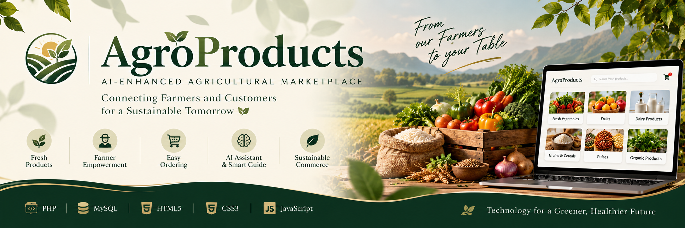

<p align="center">
  
</p>

# AgroProducts | AI-Enhanced Farm-to-Consumer Marketplace

**A full-stack agricultural marketplace connecting farmers and customers through digital product discovery, inventory management, and streamlined ordering.**

AgroProducts is a web application built to make agricultural products easier to discover and purchase online. The platform provides dedicated farmer and customer workflows, product listings, shopping-cart functionality, order processing, and an AI-focused workspace for intelligent marketplace assistance.

> **Project type:** Full-stack web application  
> **Domain:** AgriTech · E-commerce · Applied AI  
> **Status:** Local development build

---
## Application Preview

<p align="center">
  
</p>

*The AgroProducts homepage, featuring the farm-to-consumer marketplace interface.*
## Overview

Traditional agricultural supply chains can make it difficult for customers to discover products directly from farmers. AgroProducts explores how a digital marketplace can simplify product discovery, support farmer-managed listings, and provide a more structured online purchasing experience.

The application combines a PHP-based web interface with a MySQL/MariaDB database, interactive JavaScript components, and AI-oriented assistance features.

## Key Features

### 🛒 Digital Marketplace
- Browse agricultural products across supported categories.
- View product information, pricing, and available inventory.
- Use a shopping cart to organize selected products.
- Follow the application's order-processing workflow.

### 🌾 Farmer Workspace
- Farmer registration and login workflows.
- Farmer profile and product-management interfaces.
- Product listing and inventory-related operations.

### 👤 Customer Experience
- Customer registration and login workflows.
- Customer profile management.
- Product browsing, cart interactions, and order-related pages.

### 🤖 AI-Focused Workspace
- Dedicated AI Studio interface.
- AI assistant interface for marketplace-related support.
- Smart-guide interface for guided user assistance.

*AI-related interfaces are included in the project. Their available responses and integrations depend on the configured implementation; this repository does not claim independently benchmarked AI performance.*

### 🗄️ Data Management
- Relational database structure for marketplace data.
- Product, customer, farmer, order, and order-item data models.
- SQL schema provided to support local database setup.

---

## Technology Stack

| Layer | Technologies |
|---|---|
| Frontend | HTML5, CSS3, JavaScript |
| Backend | PHP |
| Database | MySQL / MariaDB |
| Local development | XAMPP, Apache |
| Interface features | Interactive cart, marketplace pages, AI-focused workspace |
| Source control | Git and GitHub |

---

## Application Architecture

```text
Customer / Farmer
        |
        v
HTML + CSS + JavaScript
        |
        v
PHP Application
        |
        v
MySQL / MariaDB
        |
        v
Products · Profiles · Orders
```

The AI-focused interfaces form an additional application layer. External AI services, if required by the implementation, must be configured separately.

---

## Getting Started

### Prerequisites

Install the following on your local computer:

- [XAMPP](https://www.apachefriends.org/) with Apache, PHP, and MySQL/MariaDB.
- A web browser.
- [GitHub repository](https://github.com/Bindushree-25/agroproducts-ai-marketplace) source files.

### 1. Download the project

Clone the repository:

```bash
git clone https://github.com/Bindushree-25/agroproducts-ai-marketplace.git
```

Alternatively, select **Code → Download ZIP** on GitHub and extract the files.

### 2. Place the project in XAMPP

Copy the project folder into XAMPP's `htdocs` directory.

For example:

```text
C:\xampp\htdocs\AgroProducts
```

Keep `index.php`, the PHP application files, stylesheets, JavaScript files, and the `images` directory together in the project root.

### 3. Start the local server

Open the XAMPP Control Panel and start:

- Apache
- MySQL

### 4. Set up the database

1. Open [phpMyAdmin](http://localhost/phpmyadmin/) in your browser.
2. Create the database required by the application.
3. Import `database_schema.sql` if it contains the required table definitions.
4. Review the database names and tables expected by the application's PHP files.
5. Configure the local database connection in `db_connect.php` to match your XAMPP settings.

**Important:** A schema file may create tables without supplying the product catalogue or other initial records. If required, add appropriate sample data before testing the application.

### 5. Configure local settings

Review `config.local.example.php` for the intended local configuration process.

Use your own local database settings. Never publish real passwords, API keys, private configuration files, or production credentials.

### 6. Run the application

If the project is placed at `C:\xampp\htdocs\AgroProducts`, open:

```text
http://localhost/AgroProducts/
```

If you use a different folder name, adjust the URL accordingly.

---

## Repository Structure

```text
agroproducts-ai-marketplace/
├── index.php
├── README.md
├── .gitignore
├── database_schema.sql
├── db_connect.php
├── header.php
├── footer.php
├── shop.php
├── shop.js
├── cart.php
├── cart.js
├── ai_studio.php
├── ai-studio.js
├── ai_assistant.php
├── smart_guide.php
├── smart-guide.js
├── farmer_dashboard.php
├── manage_products.php
├── upload_product.php
├── customer_*.php
├── farmer_*.php
├── process_*.php
├── style.css
├── stylebck.css
└── images/
```

The structure above highlights the principal application files; additional supporting PHP pages and image assets are also included.

---

## Engineering Highlights

This project brings together several practical full-stack development concepts:

- **Role-oriented workflows:** separate farmer and customer experiences.
- **Database-backed application design:** relational entities for marketplace operations.
- **Interactive frontend behaviour:** JavaScript-driven cart and user interactions.
- **Modular PHP pages:** reusable layout components and separated workflow handlers.
- **Applied AI interface design:** dedicated assistant and smart-guide experiences.
- **Local deployment:** a reproducible development environment using XAMPP.

## Screenshots & Demonstration

Screenshots of the actual running application will be added here to demonstrate:

1. Marketplace homepage and product catalogue.
2. Farmer dashboard and product management.
3. Shopping cart and order workflow.
4. AI Studio and assistant interfaces.

Use screenshots captured from the working application. Do not use mockups as evidence of implemented functionality.

## Current Limitations

- The project is designed for local development with XAMPP; a public production deployment is not included here.
- AI-related features depend on their actual implementation and configuration.
- Database initialization may require sample records in addition to the schema.
- Payment processing, authentication security, authorization, and order workflows require further testing before production use.
- Production deployment should include secure credential management, input validation, access control, and appropriate handling of payment information.

## Future Improvements

- Automated tests for core marketplace workflows.
- Improved authentication and role-based authorization.
- More comprehensive order and inventory validation.
- Secure payment-provider integration.
- Expanded AI assistance with documented evaluation.
- Responsive accessibility improvements and deployment automation.

## Learning Outcomes

AgroProducts provides practical experience in PHP application development, relational database design, frontend interaction, marketplace workflows, and the integration of AI-oriented user experiences.

## Author

**Bindushree C**  
Computer Science Engineering — Artificial Intelligence & Machine Learning

- GitHub: [@Bindushree-25](https://github.com/Bindushree-25)

---

*Developed as an academic software project exploring digital agricultural commerce and AI-enhanced user experiences.*
